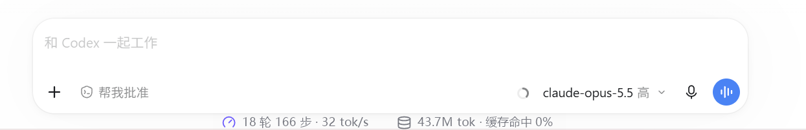
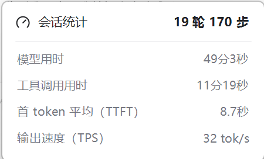
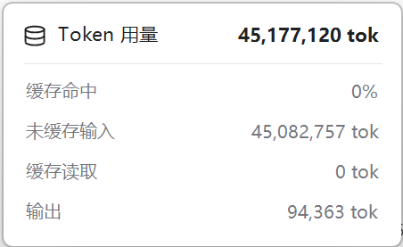

# Codex Session Stats (session-stats)

**English** | [简体中文](README.zh-CN.md)

Live statistics for your current Codex desktop session: turns, steps, model and tool time, time to first token, output speed, and token cache usage.



Click either summary to open its detail card:

<p>
  
  
</p>

> The UI labels are currently in Simplified Chinese (for example, 会话统计 means "Session stats" and Token 用量 means "Token usage").

The project has two parts, and you can use either one on its own:

- **Codex plugin**: type `@会话统计` in a chat to open the stats panel inline or in a side tab. It refreshes every 3 seconds.
- **Bottom bar (Windows only)**: a small transparent bar centered right below the Codex composer that follows the Codex window. Click a summary to open a detail card; click anywhere else to close it. After the first run it starts automatically when you sign in to Windows.

All data is read locally from the session logs Codex writes to `~/.codex/sessions`. Nothing is uploaded.

## What it shows

| Group | Items |
| --- | --- |
| Session stats | Turns, steps, model time, tool time, average time to first token (TTFT), output speed (TPS) |
| Token usage | Total tokens, cache hit rate, uncached input, cached input, output |

The panel also shows current context window usage.

### How the numbers are calculated

- **Token counts** come straight from the cumulative usage in the Codex logs, so they are exact.
- **TTFT** comes from the per-turn first-token time Codex records. A turn that is still running has no value yet, so it may briefly show `—`.
- **Model time** is each turn's duration minus the time spent in tool calls. It still includes time spent waiting for the first token and short gaps between steps.
- **Output speed** is output tokens divided by **generation time**: the time Codex records between the first and last token of each reasoning block and reply, with overlaps counted once. Waiting for the first token, tool calls, and gaps between steps are excluded, so it reflects how fast the model actually writes. If a log has no such timing, it falls back to output tokens divided by model time.
- **Update cadence**: Codex writes usage once per step, so the numbers jump step by step rather than counting up token by token.

## Requirements

- Codex desktop app with plugin and MCP Apps support
- Node.js 18 or later, with `node` on your `PATH`
- For the bottom bar: Windows 10/11 and the built-in .NET Framework 4.x (used to compile it)

## Install the plugin

```bash
git clone https://github.com/QingYi625/codex-session-stats.git
codex plugin marketplace add ./codex-session-stats
codex plugin add session-stats@local-session-stats
```

After installing, **start a new chat** (chats that were already open do not load new plugins), then type `@会话统计` or ask Codex to open the session stats panel.

In the panel you can switch which chat to track or pause auto-refresh.

To uninstall:

```bash
codex plugin remove session-stats
```

## Bottom bar (Windows)

The bar ships as source code. Compile it once on your machine:

```bat
plugins\session-stats\bar\build.cmd
```

This produces `plugins\session-stats\bar\SessionStatsBar.exe`. Double-click it to run.

**On first run it registers itself to start when you sign in**, so you don't have to launch it again. It waits in the background, appears when Codex is open, and hides when Codex is closed or minimized.

- The bar is only shown while the Codex window is visible.
- By default it tracks **the most recently active chat**.
- Click either summary to open its details. Click the same summary again or anywhere else to close them.
- Right-click the bar to toggle start-on-sign-in (开机自启) or to quit (退出会话统计条).
- The background is transparent, and the text switches between dark and light based on what is behind it.

### Start on sign-in

Codex only starts a plugin's server when a chat uses that plugin, not when the app opens, so the plugin cannot launch the bar together with Codex. Starting the bar on sign-in is how it is ready whenever you open Codex.

- **On by default**: the first run writes the exe path to your user startup entry (`HKCU\Software\Microsoft\Windows\CurrentVersion\Run`, value `CodexSessionStatsBar`). No administrator rights are needed, and only the current user is affected.
- **Turn it off**: right-click the bar and uncheck 开机自启. Your choice is remembered, so later runs won't turn it back on. Check it again to re-enable. You can also disable it in Task Manager → Startup apps.
- **Never enable it**: pass `--no-autostart` on the first run:

  ```bat
  plugins\session-stats\bar\SessionStatsBar.exe --no-autostart
  ```

- **Moved the folder?** The startup entry stores the full exe path. Run the exe once from its new location to update it.
- **Uninstall**: right-click the bar, uncheck 开机自启, quit, then delete the folder. If you already deleted the folder, remove or disable `SessionStatsBar` in Task Manager → Startup apps. Settings are stored under `HKCU\Software\CodexSessionStats`, which you can delete too.

### How it works

- A Windows event hook keeps the bar following the Codex window as it moves.
- UI Automation reads the actual position of the Codex composer, so the bar stays centered after maximizing, resizing, or collapsing the sidebar.
- While a detail card is open, a low-level mouse hook detects clicks outside it so it can close. The hook is removed as soon as the card closes, and it only checks click positions without recording any input.
- Start-on-sign-in only writes the current user's `Run` registry value. It does not create scheduled tasks or services.

## Project layout

```text
.agents/plugins/marketplace.json     Local plugin marketplace manifest
plugins/session-stats/
  plugin.json                        Plugin manifest (Agent Plugins format)
  .codex-plugin/plugin.json          Codex compatibility manifest
  mcp.json / .mcp.json               MCP server configuration
  server/stats.mjs                   Parses session logs and computes stats
  server/index.mjs                   MCP server (stdio, no dependencies)
  server/bar-feed.mjs                Feeds data to the bottom bar
  ui/panel.html                      Stats panel (MCP App)
  skills/session-stats/SKILL.md      Tells Codex when to open the panel
  bar/StatsBar.cs                    Bottom bar source
  bar/build.cmd                      Bottom bar build script
```

## Caveats

- The session log format is an internal Codex detail, not a public API. A Codex update may break the stats until the parser is updated.
- The bottom bar is a separate small window, not part of the Codex UI, so it may lag slightly when you drag the window quickly.
- The chat area position is read through UI Automation. If that fails, the bar falls back to an estimate based on the window size.
- This project is not affiliated with OpenAI and is not an official plugin.

## License

[MIT](LICENSE)
