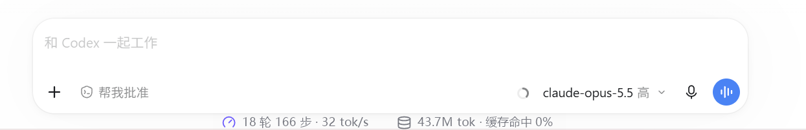
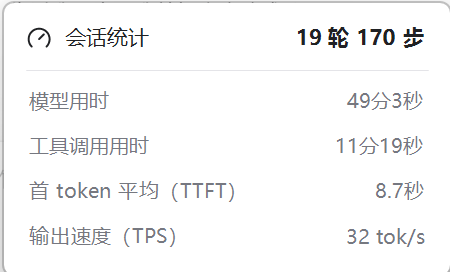
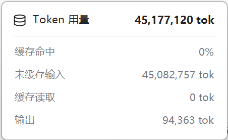

# Codex 会话统计（session-stats）

[English](README.md) | **简体中文**

在 Codex 桌面版里实时查看当前会话的轮数、步数、用时、首 token 时间、输出速度和 Token 缓存用量。



点击任一组摘要会弹出详情：

<p>
  
  
</p>

本项目包含两部分，可以单独使用：

- **Codex 插件**：在对话里输入 `@会话统计`，会在对话中或右侧标签页打开统计面板，每 3 秒刷新一次。
- **底部统计条（仅 Windows）**：一个透明的小条，贴在 Codex 输入框正下方并居中显示，跟随 Codex 窗口移动。点击其中一组摘要会弹出详情卡片，点击其他地方自动关闭。首次运行后默认开机自启。

所有数据都只在本机读取，来源是 Codex 写在本地的会话日志（`~/.codex/sessions`），不会上传。

## 显示的数据

| 分组 | 项目 |
| --- | --- |
| 会话统计 | 轮数、步数、模型用时、工具调用用时、首 token 平均（TTFT）、输出速度（TPS） |
| Token 用量 | Token 总量、缓存命中率、未缓存输入、缓存读取、输出 |

面板里还会显示当前上下文占用。

### 数据口径

- **Token 数**：直接取自 Codex 日志里的累计用量，是精确值。
- **TTFT**：取自 Codex 记录的每轮首 token 时间；还在进行中的一轮没有这个值，所以有时会暂时显示 `—`。
- **模型用时**：每轮总时长减去其中工具调用占用的时间，是估算值。
- **输出速度**：输出 Token 数除以模型用时，是估算值，可能和其他工具显示的数字不同。
- **刷新节奏**：Codex 每完成一步才写一次用量，所以数字是一步一步跳的，不是逐字增长。

## 环境要求

- Codex 桌面版（需要支持插件和 MCP Apps）
- Node.js 18 或更高版本，并且 `node` 在 `PATH` 里
- 底部统计条额外需要 Windows 10/11，以及系统自带的 .NET Framework 4.x（用来编译）

## 安装插件

```bash
git clone https://github.com/QingYi625/codex-session-stats.git
codex plugin marketplace add ./codex-session-stats
codex plugin add session-stats@local-session-stats
```

装好后**新建一个对话**（已经打开的对话不会加载新插件），输入 `@会话统计` 或“打开会话统计面板”即可。

面板里可以切换要统计的会话，也可以暂停自动刷新。

卸载：

```bash
codex plugin remove session-stats
```

## 底部统计条（Windows）

统计条以源码形式提供，需要先在本机编译一次：

```bat
plugins\session-stats\bar\build.cmd
```

编译后会生成 `plugins\session-stats\bar\SessionStatsBar.exe`，双击运行即可。

**首次运行后会自动设为开机自启**，以后不用再手动打开：它开机后在后台等待，打开 Codex 时统计条自动出现，关闭或最小化 Codex 时自动隐藏。

- 统计条只在 Codex 窗口可见时显示，Codex 最小化时自动隐藏。
- 默认统计**最近活动的会话**。
- 点击“会话统计”或“Token 用量”摘要会弹出详情，再点同一组、点其他地方都会关闭。
- 右键统计条可以切换“开机自启”，或退出。
- 背景透明，会根据背后颜色自动切换深色或浅色文字。

### 开机自启

统计条是一个独立的小程序，Codex 只在对话里用到插件时才会启动插件服务，打开 Codex 时不会顺带启动它，所以统计条用开机自启来保证“打开 Codex 就有”。

- **默认开启**：首次运行时，会在当前用户的启动项（`HKCU\Software\Microsoft\Windows\CurrentVersion\Run`，名称 `CodexSessionStatsBar`）里写入 exe 的路径。不需要管理员权限，只影响当前用户。
- **关闭**：右键统计条，取消勾选“开机自启”。关闭后会记住你的选择，以后运行也不会再自动开启；想恢复就再勾选一次。也可以在“任务管理器 → 启动应用”里禁用。
- **从一开始就不要自启**：首次运行时加参数 `--no-autostart`：

  ```bat
  plugins\session-stats\bar\SessionStatsBar.exe --no-autostart
  ```

- **移动了文件夹**：启动项记录的是 exe 的完整路径。移动仓库后重新运行一次 exe，它会把路径更新成新位置。
- **卸载**：先右键统计条取消“开机自启”，再退出并删除文件夹。如果已经先删了文件夹，在“任务管理器 → 启动应用”里删除或禁用 `SessionStatsBar` 即可。设置记录保存在 `HKCU\Software\CodexSessionStats`，可以一并删除。

### 工作原理

- 用 Windows 窗口事件钩子跟随 Codex 窗口移动。
- 用 UI Automation 读取 Codex 输入框的实际位置，保证最大化、调整大小、收起侧边栏后仍然居中。
- 打开详情时会临时注册一个低级鼠标钩子，用来实现“点外面关闭”，关闭详情后立即注销。钩子只判断点击位置，不记录任何输入。
- 开机自启只写当前用户的 `Run` 注册表项，不创建计划任务或服务。

## 项目结构

```text
.agents/plugins/marketplace.json     本地插件市场清单
plugins/session-stats/
  plugin.json                        插件清单（Agent Plugins 格式）
  .codex-plugin/plugin.json          Codex 兼容清单
  mcp.json / .mcp.json               MCP 服务配置
  server/stats.mjs                   解析会话日志、计算统计
  server/index.mjs                   MCP 服务（stdio，零依赖）
  server/bar-feed.mjs                给底部统计条输出数据
  ui/panel.html                      统计面板（MCP App）
  skills/session-stats/SKILL.md      让 Codex 知道何时打开面板
  bar/StatsBar.cs                    底部统计条源码
  bar/build.cmd                      统计条编译脚本
```

## 注意事项

- 会话日志的格式是 Codex 的内部实现，不是公开接口。Codex 更新后统计可能失效，届时需要跟着调整解析代码。
- 底部统计条是一个独立的小窗口，并不是 Codex 界面的一部分；快速拖动窗口时可能有轻微拖影。
- 对话区的位置靠 UI Automation 读取，读不到时会退回按窗口比例估算。
- 本项目与 OpenAI 无关，不是官方插件。

## 许可证

[MIT](LICENSE)
